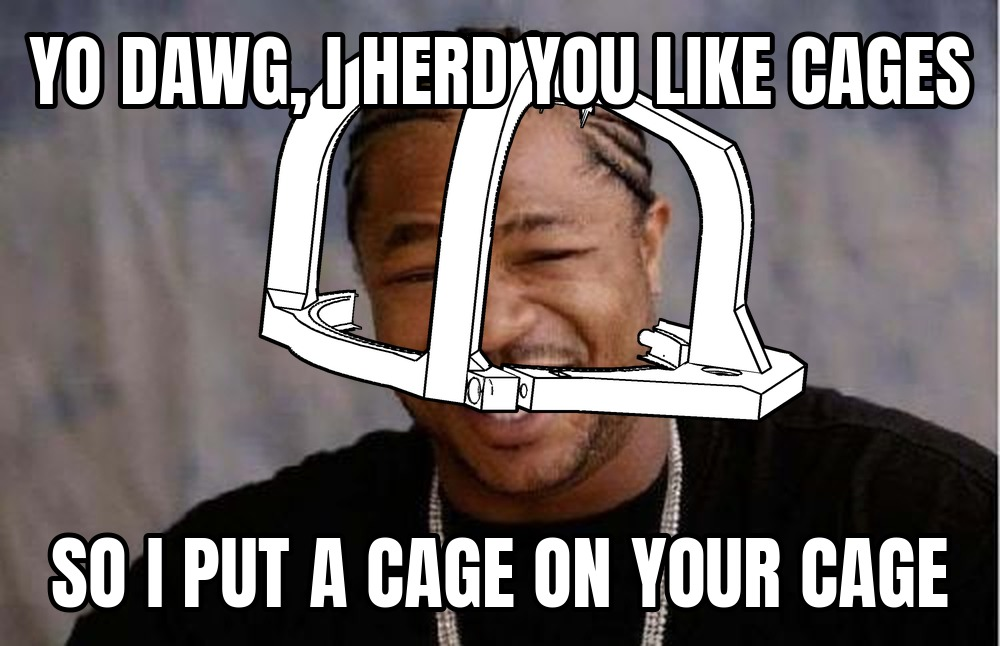
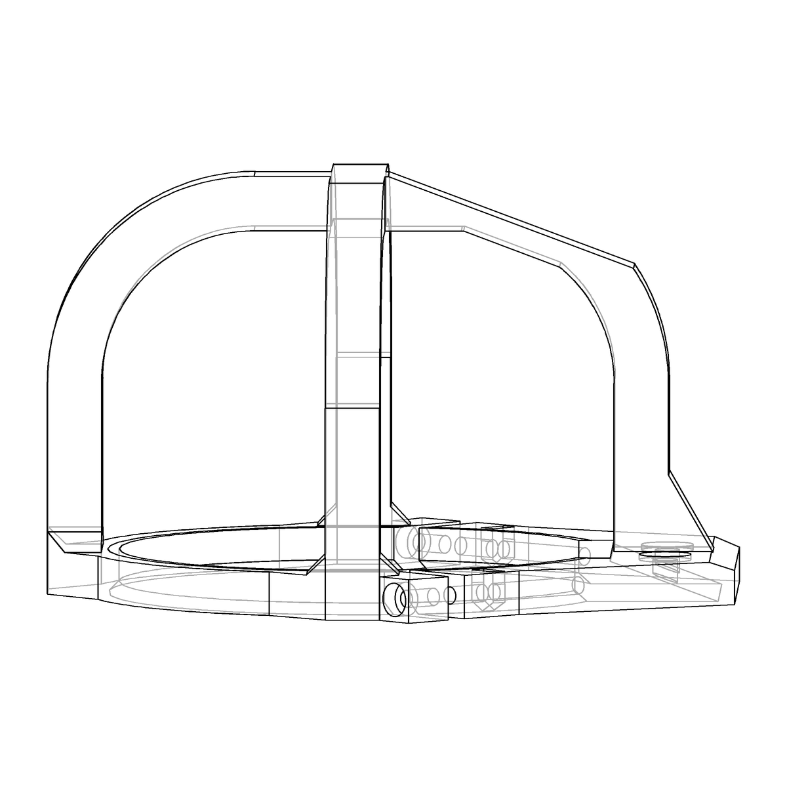
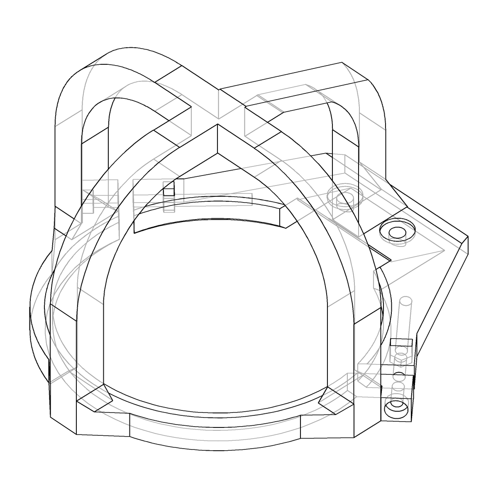
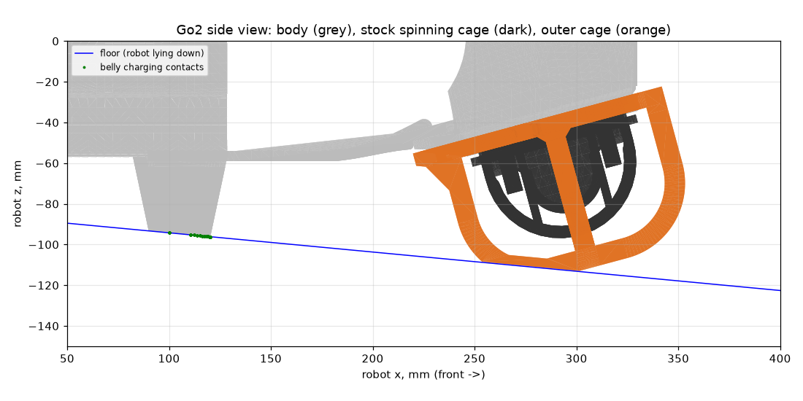
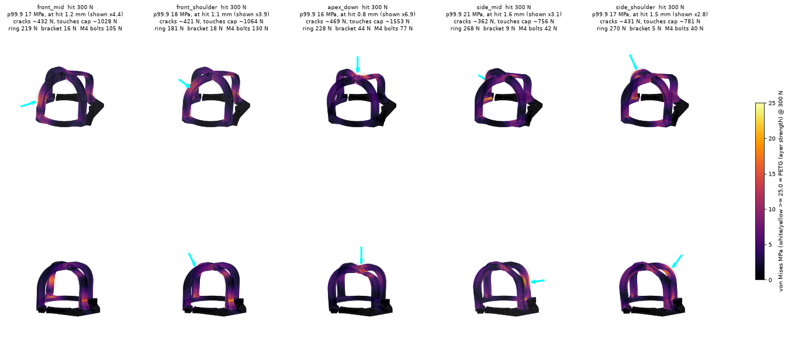

# Go2 lidar cage cage



A fixed, 3D-printed outer cage for the Unitree Go2's L1 lidar.

The stock black cage is bolted to the lidar's **spinning** head. When the robot bumps the lidar into a stair or obstacle, that cage grabs and the lidar stalls. This cage is mounted to the non-spinning parts of the head instead. It's a cage for the cage.

| | |
|---|---|
|  |  |

One printed piece:

- **Ring:** hugs the grey, non-spinning housing just below the rim. Everything above the rim spins.
- **Two M3 pinch clamps:** each squeezes a slit in the ring, so the ring grips the housing.
- **Tab:** bolts onto the grey chin bracket, reusing its 2× M4 screws.

## Files

| file | |
|---|---|
| [`go2-lidar-cage.stl`](go2-lidar-cage.stl) | print file, ring down, 126 × 126 × 77 mm, 65 cm³ (~85 g PETG) |
| [`go2-lidar-cage.step`](go2-lidar-cage.step) | same part as STEP, in the lidar frame (see `assembly.py`) |
| [`assembly.py`](assembly.py) | parametric model ([build123d](https://github.com/gumyr/build123d)) |
| [`fea_bumps.py`](fea_bumps.py), [`render_bumps.py`](render_bumps.py) | bump FEA and its renders |
| [`floor_check.py`](floor_check.py) | robot-lying-down floor clearance |
| [`ref/`](ref/) | decimated Go2 head mesh used as a visual reference in the viewer |

## Print and hardware

- **Material:** PETG, 100% infill (or at least 6 walls).
- **Orientation:** ring down, as in the STL.
- **Supports:** under the hoop crowns and under the tab, where it sits on the sloped bracket.
- **M4:** 2× socket head, about 4 mm longer than the stock bracket screws.
- **M3:** 2× socket head plus 2× M3 nuts for the pinch clamps.
  - **Length:** anything from 25 to 60 mm (the hole runs all the way through).
  - **Nuts:** drop into the slot from the top of the rear ear.

## Robot lying down

When the robot lies down, it rests on its four belly charging contacts, nose up about 5°. The cage must not reach the floor before the contacts do.



## Bump tests (FEA)

Linear-static FEA of a 300 N hit at five spots, PETG, pinch clamps gripping the housing (`fea_bumps.py`):

```sh
khana export assembly.py:build_print
MKL_NUM_THREADS=4 FEA_OUT=outputs/fea uv run fea_bumps.py outputs/assembly-build_print/assembly.step
FEA_OUT=outputs/fea uv run render_bumps.py
```

The table gives the hit force at which the cage first cracks (p99.9 stress reaches 25 MPa) and at which it bends onto the spinning cap. For reference, the robot weighs about 150 N.

| hit | cracks | touches cap |
|---|---|---|
| front, mid-height | 432 N | 1028 N |
| front, upper corner (45°) | 421 N | 1064 N |
| straight down on top | 469 N | 1553 N |
| side, mid-height | 362 N | 756 N |
| side, upper corner (45°) | 431 N | 781 N |

The cage takes about 2.5–3× the robot's weight anywhere before cracking. Full results are in `docs/fea_results.json`.



## Rebuild / modify

Install [cad-khana](https://github.com/cyberchitta/cad-khana) (it brings build123d) with the [OCP CAD Viewer](https://github.com/bernhard-42/vscode-ocp-cad-viewer) in the same environment:

```sh
uv tool install --python 3.13 --with ocp-vscode git+https://github.com/cyberchitta/cad-khana
~/.local/share/uv/tools/cad-khana/bin/python -m ocp_viewer   # viewer at http://localhost:3939/viewer, leave running
```

```sh
khana check  assembly.py                 # clearance asserts vs the spinning cage, one solid
khana view   assembly.py:build_view      # into the viewer (head mesh + floor shown)
khana export assembly.py:build_print     # -> outputs/assembly-build_print/assembly.{stl,step}
```

Tests (fit asserts, floor clearance, committed STL matches the model; also run on every push):

```sh
uv run --python 3.13 --with git+https://github.com/cyberchitta/cad-khana --with pytest pytest
```

`floor_check.py` and `ref/remesh_head.py` need the Go2 meshes from [mujoco_menagerie](https://github.com/google-deepmind/mujoco_menagerie/tree/main/unitree_go2):

```sh
curl -sL -o "ref/base_#1.obj" "https://raw.githubusercontent.com/google-deepmind/mujoco_menagerie/main/unitree_go2/assets/base_[0-4].obj"
uv run floor_check.py
```

## License

[GPL-3.0](LICENSE), except `docs/yodawg.jpg` (the "Yo Dawg" meme template photo). `ref/head_shell_8000.stl` is derived from Unitree's Go2 model via MuJoCo Menagerie and keeps its BSD license, see [`ref/LICENSE-unitree-go2`](ref/LICENSE-unitree-go2).
