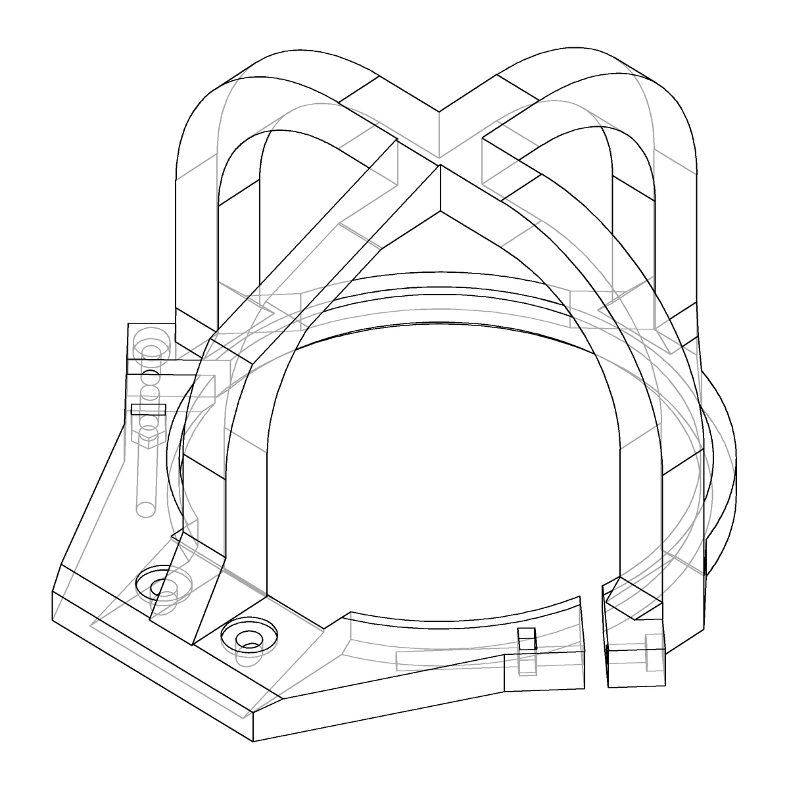
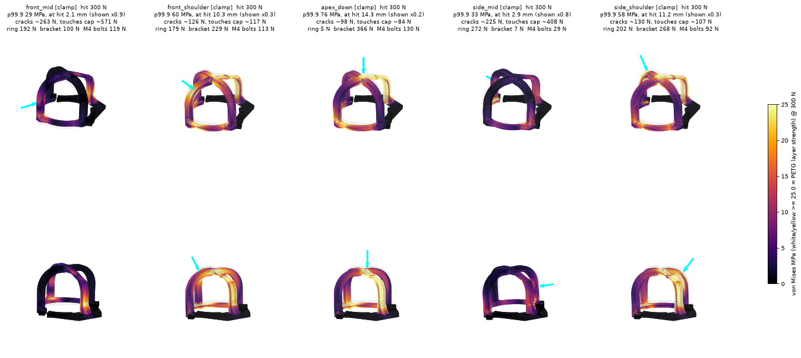

# Go2 lidar cage cage

A fixed, 3D-printed outer cage for the Unitree Go2's L1 lidar.

The stock black cage is bolted to the lidar's **spinning** head. When the robot bumps the lidar into a stair or obstacle, that cage grabs and the lidar stalls. This cage is mounted to the non-spinning parts of the head instead. It's a cage for the cage.

| | |
|---|---|
|  |  |

One printed piece:

- **Ring:** hugs the grey, non-spinning housing just below the rim. Everything above the rim spins.
- **Two M3 pinch clamps:** each squeezes a slit in the ring, so the ring grips the housing.
- **Tab:** bolts onto the grey chin bracket, reusing its 2× M4 screws.
- **Two hoops (fore-aft and lateral):** 10 × 10 mm bars arching over the spinning cage, 4 mm clear of it on the legs and 3 mm at the crown.

## Files

| file | |
|---|---|
| `go2-lidar-cage.stl` | print file, ring down, 126 × 126 × 77 mm, 65 cm³ (~85 g PETG) |
| `go2-lidar-cage.step` | same part as STEP, in the lidar frame (see `assembly.py`) |
| `assembly.py` | parametric model ([build123d](https://github.com/gumyr/build123d) + [cad-khana](https://github.com/cyberchitta/cad-khana)) |
| `fea_bumps.py`, `render_bumps.py` | bump FEA and its renders |
| `floor_check.py` | robot-lying-down floor clearance |
| `ref/` | decimated Go2 head mesh used as a visual reference in the viewer |

## Print and hardware

- **Material:** PETG, 100% infill (or at least 6 walls).
- **Orientation:** ring down, as in the STL.
- **Supports:** under the hoop crowns and under the tab, where it sits on the sloped bracket.
- **M4:** 2× socket head, about 4 mm longer than the stock bracket screws. They go into the bracket's existing holes, parallel to the lidar axis, and their heads sit in a 1 mm pocket.
- **M3:** 2× socket head plus 2× M3 nuts for the pinch clamps.
  - **Length:** anything from **25 mm** (shortest standard size that passes the nut; 25 is what we use) up to about 60 mm. The hole runs all the way through, so longer screws just go deeper.
  - **Nuts:** drop into the slot from the top of the rear ear.

**Fitting:**

1. Slide the cage over the lidar from the dome side.
2. Seat the tab on the chin bracket and fit the M4 screws.
3. Tighten both M3 clamps until the ring grips the housing.

## Robot lying down

When the robot lies down, it rests on its four belly charging contacts, nose up about 5°. The cage must not reach the floor before the contacts do.

On that floor line, the spinning cap's back shoulder is only about 7 mm from the floor. So the whole cage is trimmed 0.3 mm short of the floor line. At the back corner of the fore-aft hoop, the bar's inner face is pulled in to 1.6 mm from the cap, which leaves that corner about 4.5 mm deep. The back corner mostly ties the tab to the rest of the cage; the hits land on the front and the sides.


## Bump tests (FEA)

`fea_bumps.py` is a linear-static FEA:

- **Mesh and solver:** gmsh P2 tets, solved with scikit-fem and pardiso.
- **Material:** PETG, E = 2000 MPa. Strength is ~45 MPa in-plane but only ~25 MPa across layers, so 25 MPa counts as a crack.
- **Load:** a 300 N hit spread over a ~7 mm patch, at the outermost point of the cage in each direction.
- **Holds:**
  - **grip:** the M4 holes are fixed, the tab rests on the bracket, and the ring bore is held in every direction. This is a clamp that doesn't slip. On the robot the clamp holds firmly, so this is the realistic case.
  - **clamp:** the same, but the bore only pushes outward (frictionless). This is the worst case, a loose clamp.

The table gives the hit force at which the cage first cracks (p99.9 stress reaches 25 MPa) and at which it bends onto the spinning cap. For reference, the robot weighs about 150 N.

| hit | grip: cracks | grip: touches cap | clamp: cracks | clamp: touches cap |
|---|---|---|---|---|
| front, mid-height | 432 N | 1028 N | 263 N | 571 N |
| front, upper corner (45°) | 421 N | 1064 N | 126 N | 117 N |
| straight down on top | 469 N | 1553 N | 98 N | 84 N |
| side, mid-height | 362 N | 756 N | 225 N | 408 N |
| side, upper corner (45°) | 431 N | 781 N | 130 N | 107 N |

"Touches cap" assumes 4 mm of clearance. At the crown it is 3 mm, so scale the top hits by about ¾.

A firm clamp matters. With the ring gripping, a hit spreads into the housing and the cage takes about 3× the robot's weight anywhere. If the ring can slip, hits on the top bend the hoops onto the cap at about 100 N. A strip of rubber or TPU inside the bore helps if it ever slips. Full results are in `docs/fea_results.json`.

**grip:**


**clamp (frictionless bore):**


## Rebuild / modify

Install [cad-khana](https://github.com/cyberchitta/cad-khana); it brings build123d with it.

```sh
khana check  assembly.py                 # clearance asserts vs the spinning cage, one solid
khana view   assembly.py:build_view      # browser viewer (head mesh + floor shown)
khana export assembly.py:build_print     # -> outputs/assembly-build_print/assembly.{stl,step}

MKL_NUM_THREADS=4 FEA_OUT=outputs/fea uv run fea_bumps.py outputs/assembly-build_print/assembly.step
FEA_OUT=outputs/fea uv run render_bumps.py grip
```

`floor_check.py` and `ref/remesh_head.py` need the Go2 meshes from [mujoco_menagerie](https://github.com/google-deepmind/mujoco_menagerie/tree/main/unitree_go2):

```sh
for i in 0 1 2 3 4; do curl -sLo ref/base_$i.obj https://raw.githubusercontent.com/google-deepmind/mujoco_menagerie/main/unitree_go2/assets/base_$i.obj; done
uv run floor_check.py
```

### Frame and measured numbers

The model works in the lidar frame (mm):

- **Origin:** the URDF radar origin.
- **+Z:** the lidar axis, pointing out of the head.
- **+X:** toward the body, along the chin bracket.

| measured on the robot | value |
|---|---|
| Spinning cap | 84 mm diameter, 56 mm tall above the rim |
| Grey housing | 87 mm diameter for 8 mm below the rim |
| Chin bracket | 35 mm wide, M4 screws 20 mm apart |
| M4 position | 56.5 mm from the lidar axis (fitted on test prints) |

The bracket slope (20.4°) comes from the mesh and is confirmed by fit.

`ref/head_shell_8000.stl` is derived from Unitree's Go2 model via MuJoCo Menagerie; see `ref/LICENSE-unitree-go2`.
